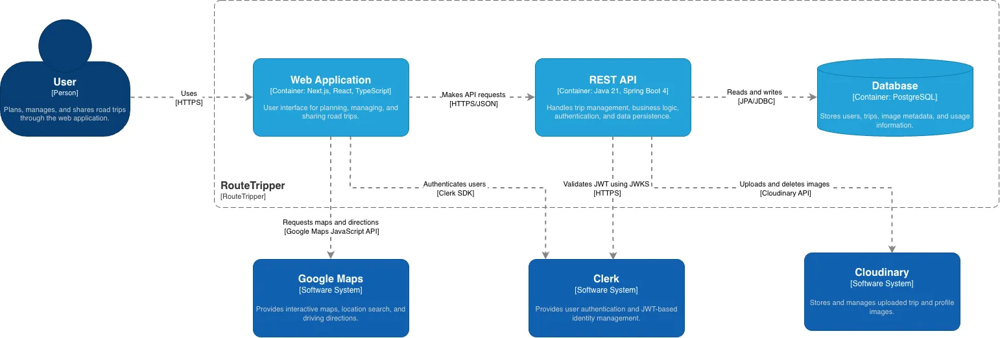

# RouteTripper API

REST API for [RouteTripper](https://routetripper.com/), a web application for planning, managing, and sharing road trips.

Built with Java and Spring Boot as a hands-on project to explore backend development, application architecture, and database management.

**Live Application:** [RouteTripper](https://routetripper.com/)  
**Frontend Repository:** [trip-planner-web](https://github.com/SzymonGos/trip-planner-web)

## Features

- Trip CRUD operations
- JWT authentication and resource ownership checks
- Image uploads and Cloudinary integration
- Trip pagination
- Server-side validation and business rules
- Database migrations with Flyway
- Extended automated test coverage
- API documentation with Swagger/OpenAPI

## Application Architecture

A layered monolithic architecture organized by domain features.

- **Controllers** — REST endpoints and request handling.
- **Services** — business logic, authorization, and transactions.
- **Repositories** — database access through Spring Data JPA.
- **DTOs & Mappers** — separation between API contracts and persistence entities.
- **Security** — JWT validation with Spring Security and Clerk.

## Technical Decisions

- **PostgreSQL transactions** — maintain consistency during database operations.
- **AFTER_COMMIT events** — trigger Cloudinary image cleanup after successful database commits.
- **Flyway migrations** — version-controlled database changes.
- **Spring Data Slice** — pagination supporting incremental loading without total-count queries.

## Technologies

Java 21 · Spring Boot 4 · Spring Security · Spring Data JPA · PostgreSQL · Flyway · MapStruct · Cloudinary · Maven
